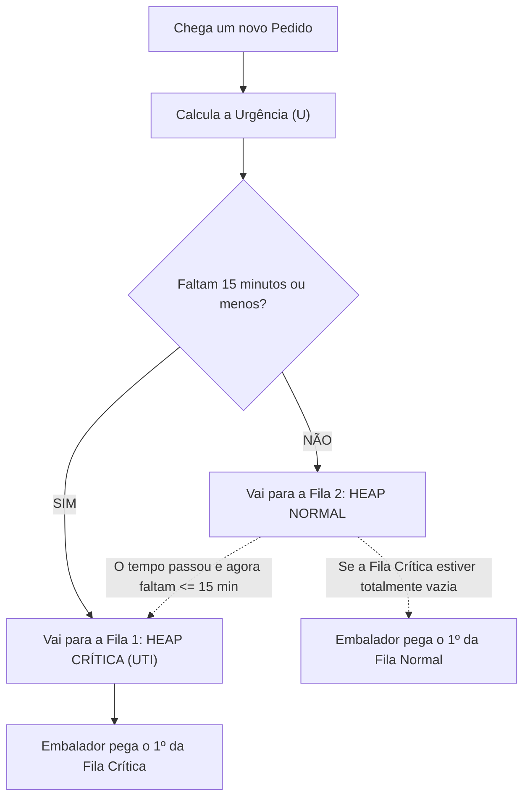

# 🎓 Guia Definitivo e Didático: Entendendo o Projeto MPS da VelozMart

> **Aviso:** Este documento foi criado para você estudar e entender 100% do projeto do seu grupo, com analogias simples do dia a dia, tradução de todos os termos em inglês, passo a passo dos cálculos e respostas para perguntas que os professores possam fazer.

---

## 🧭 Sumário
1. [O enunciado deu 3 opções? O que nós fizemos?](#1-o-enunciado-deu-3-opções-o-que-nós-fizemos)
2. [Dicionário de Inglês e Termos Técnicos Descomplicados](#2-dicionário-de-inglês-e-termos-técnicos-descomplicados)
3. [A Grande Analogia: O Galpão da VelozMart é um Pronto-Socorro](#3-a-grande-analogia-o-galpão-da-velozmart-é-um-pronto-socorro)
4. [Entendendo a Matemática (Fórmula da Urgência) Passo a Passo](#4-entendendo-a-matemática-fórmula-da-urgência-passo-a-passo)
5. [O que é uma "Heap" e por que usamos "Duas Heaps"?](#5-o-que-é-uma-heap-e-por-que-usamos-duas-heaps)
6. [O Ciclo de Vida de um Pedido (Da Chegada até o Caminhão)](#6-o-ciclo-de-vida-de-um-pedido-da-chegada-até-o-caminhão)
7. [Perguntas que os Professores Podem Fazer (E como responder)](#7-perguntas-que-os-professores-podem-fazer-e-como-responder)

---

## 1. O enunciado deu 3 opções? O que nós fizemos?

No texto do desafio, na linha 22, diz o seguinte:
> *"Existem diversas estratégias válidas: peso composto (priorityScore × 1/dispatchWindow), duas filas (urgentes vs. normais), heap multi-chave, algoritmo de aproximação de scheduling, etc. A escolha é livre, desde que fundamentada."*

Ou seja, o professor listou **exemplos de caminhos possíveis**:
1. **Opção A - Peso Composto:** Criar uma continha matemática única que junta a nota de prioridade e o prazo restante.
2. **Opção B - Duas Filas:** Separar em uma fila só para os pedidos desesperados (urgentes) e outra para os pedidos calmos (normais).
3. **Opção C - Heap Multi-chave:** Uma estrutura que tenta comparar vários critérios ao mesmo tempo.
4. **Opção D - Algoritmo de Scheduling:** Técnicas avançadas de agendamento de tarefas industriais.

### 💡 E o que o nosso grupo fez?
Em vez de escolher apenas uma ideia isolada, **juntamos o melhor da Opção A com a Opção B**:
* Criamos **Duas Filas** (uma para quem tem menos de 15 minutos e outra para o resto).
* Implementamos essas filas usando **Heaps** (a estrutura mais rápida do mundo para saber quem é o primeiro).
* E dentro da fila normal, usamos a continha do **Peso Composto** para decidir quem passa na frente de quem!

Isso tornou o projeto **muito completo, profissional e, ao mesmo tempo, facílimo de defender!**

---

## 2. Dicionário de Inglês e Termos Técnicos Descomplicados

Se na apresentação falarem esses termos, aqui está a tradução para a vida real:

| Termo em Inglês | O que significa na prática? | Analogia do dia a dia |
| :--- | :--- | :--- |
| **SLA** *(Service Level Agreement)* | O **prazo prometido** ao cliente. "Se comprou no frete expresso, tem que chegar até as 18h". Se estourar o SLA, o cliente reclama e a empresa paga multa. | Como a garantia de "pizza entregue em 30 minutos ou é de graça". |
| **Feature** | Uma **funcionalidade nova** de um sistema ou tela. | Como o botão de "modo escuro" que o WhatsApp lança. |
| **PriorityScore** | **Nota de prioridade** (de 0 a 100). Calculada por um robô inteligente levando em conta se o cliente é VIP, se o item é caro e a distância. | Nota do passageiro no Uber ou status "Diamante" na companhia aérea. |
| **DispatchWindow** | **Janela de despacho**. É a contagem regressiva em minutos: quanto tempo falta para o pedido ter que estar dentro do caminhão. | O cronômetro da bomba ou o relógio do forno apitando. |
| **SizeCategory** | **Categoria de tamanho**: P (Pequeno), M (Médio) ou G (Grande). | Uma caixinha de celular (P), uma caixa de tênis (M) ou uma geladeira/TV de 75 polegadas (G). |
| **FIFO** *(First In, First Out)* | "Primeiro que chega é o primeiro que sai". | A fila do pão na padaria ou a fila do caixa do supermercado. |
| **Heap** *(Montículo / Pirâmide)* | Uma estrutura de computador que organiza os dados como uma pirâmide. O mais importante **sempre fica no topo**, sem precisar ordenar todo mundo. | O pódio das Olimpíadas: você só precisa saber quem ganhou o Ouro agora. |
| **Dual-Heap** | Duas pirâmides independentes trabalhando juntas. | Uma fila para quem vai fazer raio-x de emergência e outra para consulta agendada. |
| **Fast-Track** | **Pista expressa**. Uma via rápida onde só passa quem tem urgência máxima. | A pista do "Sem Parar" no pedágio ou a fila prioritária do aeroporto. |
| **Starvation** *(Inanição / Passar fome)* | O grande medo da logística! Acontece quando um pedido humilde ou grande fica esquecido eternamente no final da fila porque sempre chega alguém mais VIP na frente dele. | Aquela pessoa tímida na lanchonete que nunca é atendida porque todo mundo passa na frente dela. |
| **Throughput** *(Vazão)* | A **velocidade de saída**. Quantos pacotes a doca de embalagem consegue colocar nos caminhões por hora. | Quantos litros de água saem de uma torneira por minuto. |
| **Trade-off** | Uma escolha onde você **ganha de um lado, mas perde de outro**. Não existe solução perfeita; toda escolha tem vantagens e custos. | Comprar um carro esportivo: é super rápido (vantagem), mas gasta muita gasolina (custo). |
| **Big O Notation** *(Ex: O(log N))* | A forma que os cientistas da computação medem o cansaço do computador. Quanto menor o número de passos, mais rápido o código roda. | Procurar uma palavra no dicionário abrindo no meio ($O(\log N)$) em vez de ler página por página desde a letra A ($O(N)$). |
| **Anti-Jitter** | Trava visual para a tela do computador não ficar piscando e trocando a ordem loucamente a cada segundo, o que faria o operador clicar no botão errado. | O botão de confirmação que não sai do lugar enquanto você tenta apertar. |

---

## 3. A Grande Analogia: O Galpão da VelozMart é um Pronto-Socorro

Imagine que o galpão da VelozMart é a emergência de um hospital:

1. **A Sala Vermelha / UTI (Fila 1 - Heap Crítica / Fast-Track):**
   * Aqui só entram os pedidos que estão "morrendo"! 
   * Se faltam **15 minutos ou menos** para o prazo estourar (`dispatchWindow <= 15`), o pedido entra imediatamente nesta sala.
   * Os operadores da doca (os médicos) **nunca** atendem ninguém da fila normal se houver alguém na Sala Vermelha.

2. **A Sala de Espera Geral (Fila 2 - Heap Normal):**
   * Aqui ficam os pedidos que ainda têm tempo para respirar (mais de 15 minutos).
   * Mas como decidimos quem é atendido primeiro na sala de espera? Usamos uma **triagem inteligente (a Fórmula da Urgência)**.

3. **O Relógio não para (Promoção Automática):**
   * Se um pedido estava na sala de espera com 20 minutos de prazo, e se passam 6 minutos... o prazo dele caiu para 14 minutos!
   * Na mesma hora, o sistema apita e **promove ele para a Sala Vermelha**!
   * Isso garante **Zero Starvation**: ninguém "morre" esperando na fila. Todo mundo que fica urgente sobe de categoria.

---

## 4. Entendendo a Matemática (Fórmula da Urgência) Passo a Passo

Para os pedidos da Fila Normal, nós calculamos uma pontuação chamada **Urgência ($U$)**:

$$\text{Urgência } (U) = \left( \frac{\text{priorityScore}}{\max(\text{dispatchWindow}, 1)} \right) \times 10 + \text{Bônus de Tamanho}$$

Parece difícil? Vamos quebrar parte por parte:

### Parte 1: Por que dividir `priorityScore` pelo `dispatchWindow`?
* Pense comigo:
  * Se o cliente tem **Score 90** (super VIP) e o prazo dele é de **30 minutos**:  
    $\frac{90}{30} = 3$ pontos de pressão.
  * Mas se o cliente tem o mesmo **Score 90** e o prazo caiu para **10 minutos**:  
    $\frac{90}{10} = 9$ pontos de pressão!
* **Conclusão:** Quanto menor o tempo que resta, maior fica o resultado da divisão! A matemática reflete o "desespero".

### Parte 2: O que é esse `max(dispatchWindow, 1)`?
* Na matemática da escola, você aprendeu que **não é possível dividir por zero** (o computador dá erro e o programa trava!).
* Se faltar 0 minutos (o prazo venceu agora), o comando `max(0, 1)` faz o computador usar o número `1`. Isso evita que o sistema trave.

### Parte 3: Por que multiplicar por 10?
* É apenas uma escala para deixar os números mais bonitos e fáceis de ler para os humanos na tela (por exemplo, 43.5 pontos em vez de 4.35).

### Parte 4: O Bônus de Tamanho (A sacada de mestre da nossa equipe!)
* **Pequeno (P):** Ganha **+15 pontos** de bônus!
* **Médio (M):** Ganha **+5 pontos** de bônus!
* **Grande (G):** Ganha **0 pontos** de bônus.

> **Por que dar bônus para caixa pequena?**  
> Imagine uma mesa de embalagem. Uma caixinha pequena (P) o empacotador passa a fita em 30 segundos e despacha. Ela não ocupa espaço.  
> Uma caixa gigante de geladeira (G) ocupa a mesa inteira, exige 3 pessoas para carregar e trava a doca toda!  
> Se priorizarmos dar vazão aos pacotes pequenos que estão prontos, liberamos espaço físico na fábrica e aumentamos a quantidade de entregas por hora (**Throughput**).  
> E o pacote grande não vai ser esquecido? **Não!** Porque quando o prazo dele chegar a 15 minutos, ele vai para a Fila Crítica obrigatoriamente!

---

## 5. O que é uma "Heap" e por que usamos "Duas Heaps"?

### A fila comum (Array normal):
* Imagine uma lista no papel com 100.000 pedidos.
* Toda vez que um cliente compra um produto ou o relógio anda 1 minuto, você teria que reordenar a folha inteira do primeiro ao último nome.
* Isso exige **1,6 milhão de comparações** no computador ($O(N \log N)$). O sistema fica lerdo, esquenta o servidor e gasta dinheiro.

### A fila inteligente (Heap):
* A Heap não perde tempo ordenando quem está em 50.000º lugar ou em 80.000º lugar. Ela não quer saber!
* Ela só garante uma coisa: **o número 1 do ranking está sempre na ponta (no topo da árvore)**.
* Para colocar um pedido novo ou tirar o primeiro colocado, o computador faz apenas **~17 operações** em vez de 1,6 milhão ($O(\log N)$)!

---

## 6. O Ciclo de Vida de um Pedido (Da Chegada até o Caminhão)

1. **Chegada:** O pedido chega com sua nota, prazo e tamanho.
2. **Triagem:** O sistema calcula a nota de Urgência.
3. **Encaminhamento:** Se tem $\le 15$ min, vai pra Fila 1. Se tem mais, vai pra Fila 2.
4. **Trabalho da Doca:** O operador clica no botão "Próximo". O sistema retira o campeão da Fila 1 em microssegundos.
5. **Atualização Temporal:** De tempos em tempos, o relógio anda, e quem estiver perto de vencer é puxado automaticamente para a Fila 1.

---

## 7. Perguntas que os Professores Podem Fazer (E como responder)

### Pergunta 1: *"Por que vocês não usaram simplesmente a ordem de chegada (FIFO)?"*
* **Sua Resposta:** *"Professor, o FIFO funciona na fila do pão, mas na logística ele gera prejuízo. Um cliente VIP que comprou frete turbo de 2 horas pode chegar 5 minutos depois de um cliente comum com prazo de 3 dias. Se usássemos FIFO, o cliente VIP atrasaria e a empresa pagaria multa."*

### Pergunta 2: *"E por que não ordenar simplesmente pelo tempo que falta (quem tem menos tempo sai primeiro)?"*
* **Sua Resposta:** *"Se ordenarmos só pelo prazo, nós ignoramos o valor do cliente e a operação física da fábrica. Dois pedidos podem ter o mesmo prazo de 30 minutos: um é um celular caro de cliente VIP (caixa P) e o outro é uma churrasqueira de cliente comum (caixa G). O nosso algoritmo entende que o pacote P VIP deve ser expedido antes para liberar a doca e proteger o melhor SLA."*

### Pergunta 3: *"Como vocês garantem que um pedido grande (G) de um cliente comum nunca vai ficar esquecido (Starvation)?"*
* **Sua Resposta:** *"Pela nossa regra da Fila Crítica (Fast-Track). Mesmo que um pedido G comece com nota baixa lá no fundo da Fila Normal, o tempo não para. Assim que a janela dele atingir 15 minutos restantes, o sistema promove esse pedido imediatamente para a Fila Crítica. Lá dentro, ele passa na frente de qualquer pedido comum da Fila Normal."*

### Pergunta 4: *"O que é esse O(log N) que vocês colocaram no documento?"*
* **Sua Resposta:** *"É a complexidade computacional da Heap. Significa que, mesmo que o VelozMart tenha 100.000 ou 1 milhão de pedidos simultâneos na Black Friday, o computador consegue inserir um novo pedido ou chamar o próximo para a esteira em apenas cerca de 17 a 20 operações matemáticas, tornando a resposta instantânea em tempo real."*

---

> 💡 **Dica de Ouro para a Apresentação:**  
> Respire fundo, use as analogias do **Pronto-Socorro** e da **Fila Expressa**. A banca avalia principalmente a sua **clareza de raciocínio** e a capacidade de justificar por que essa solução é melhor do que uma fila comum. Você tem em mãos um projeto sólido e muito bem estruturado!
