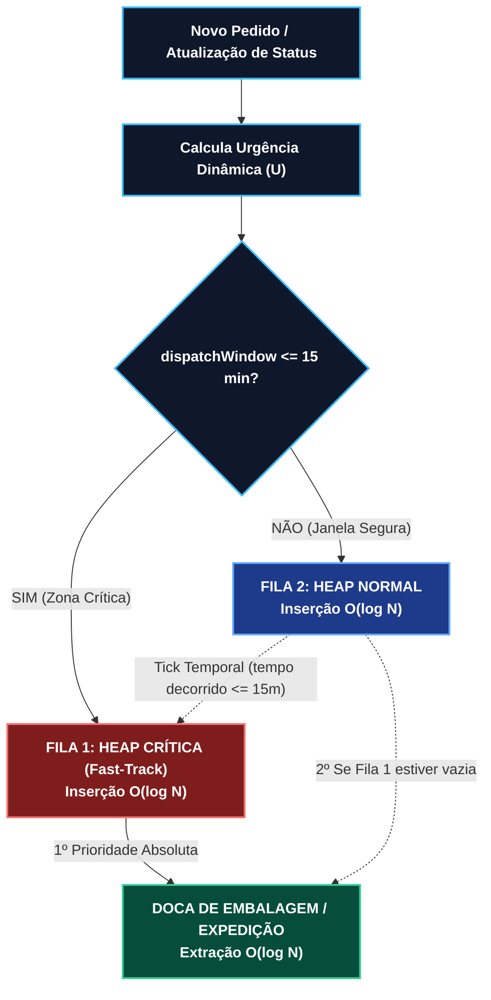

## 🏅 Participação no DiverseDev 2026

Este projeto foi desenvolvido para o [desafio](Projeto%20Final%20-%20CT%20-%20Ordenação%20e%20Prior.md) **Coding Tank — DiverseDev 2026**, da Ada em parceria com o **Mercado Eletrônico**.

### Aprovação para a 3ª fase

Nosso perfil avançou para a **3ª fase: entrevista em grupo com o Mercado Eletrônico**.

[Acesse a página oficial do processo seletivo](https://ada.tech/talentos/mercado-eletronico-diversedev-2026).


### Timeline das etapas

Confira abaixo o cronograma das etapas do processo seletivo:


## SOLUÇÃO: 📦 Marketplace Priority Sorter (MPS) — VelozMart

> **Desafio Coding Tank — 1765 | DiverseDev 2026 (Ordenação e Prioridade)**  
> **Grupo 3** • Solução algorítmica de priorização dinâmica em tempo real para expedição logística.

---

## 📌 Sumário
- [1. Visão Geral e Contexto](#-1-visão-geral-e-contexto)
- [Participação no DiverseDev 2026](#-participação-no-diversedev-2026)
- [2. O Problema das Abordagens Tradicionais](#-2-o-problema-das-abordagens-tradicionais)
- [3. Arquitetura da Solução](#-3-arquitetura-da-solução)
  - [3.1 Cálculo do Peso Composto Dinâmico](#31-cálculo-do-peso-composto-dinâmico)
  - [3.2 Estrutura Dual-Heap](#32-estrutura-dual-heap)
- [4. Diagrama de Fluxo e Decisão](#-4-diagrama-de-fluxo-e-decisão)
- [5. Análise de Complexidade e Trade-offs](#-5-análise-de-complexidade-e-trade-offs)
- [6. Acessibilidade e Interface Operacional](#-6-acessibilidade-e-interface-operacional)
- [7. Como Executar](#-7-como-executar)
- [8. Estrutura do Repositório](#-8-estrutura-do-repositório)

---

## 🎯 1. Visão Geral e Contexto

No centro de distribuição do **VelozMart**, centenas de milhares de pedidos chegam continuamente. Para cada pacote, o sistema precisa decidir instantaneamente: **qual pedido deve ser embalado e despachado a seguir?**

A solução **MPS (Marketplace Priority Sorter)** substitui filas simples de ordenação estática por um motor de **Dupla Fila de Prioridade (Dual-Heap)** que pondera simultaneamente:
1. **SLA e Janela de Despacho (`dispatchWindow`):** minutos restantes até o prazo de entrega expirar.
2. **Valor Estratégico do Cliente (`priorityScore`):** nota de 0 a 100 gerada por regras de negócio e IA.
3. **Restrição Física de Doca (`sizeCategory`):** pacotes P, M ou G, garantindo alto giro e desobstrução de bancadas.

---

## ⚠️ 2. O Problema das Abordagens Tradicionais

* **FIFO (Primeiro a Chegar, Primeiro a Sair):** Ignora urgências críticas de SLA e prioridade VIP; pedidos urgentes sofrem atrasos fatais se chegarem depois de pedidos comuns.
* **Ordenação Total por Array (`Array.sort()` / $O(N \log N)$):** A cada novo pedido ou mudança de prazo, reordenar 100.000 itens consome ~1.600.000 operações de comparação, gerando lentidão e inviabilidade em tempo real.
* ***Starvation* (Inanição):** Modelos puramente gananciosos mantêm pedidos grandes ("G") ou de score baixo eternamente esquecidos no fim da fila até estourarem o prazo.

---

## ⚙️ 3. Arquitetura da Solução

### 3.1 Cálculo do Peso Composto Dinâmico

O MPS unifica os múltiplos critérios operacionais em uma métrica contínua de **Urgência ($U$)**:

$$Urgência\ (U) = \left( \frac{priorityScore}{\max(dispatchWindow, 1)} \right) \times 10 + BônusTamanho$$

#### Bônus de Tamanho (`sizeCategory`):
* **Pequeno (`P`):** `+15 pontos` (acelera o giro da bancada e maximiza pedidos/hora).
* **Médio (`M`):** `+5 pontos` (equilíbrio operacional).
* **Grande (`G`):** `0 pontos` (processado com base estrita em urgência/prazo).

### 3.2 Estrutura Dual-Heap

Para garantir tempo real e **Zero Starvation**, o sistema desacopla o fluxo em duas Heaps:

| Fila | Estrutura | Regra de Entrada | Propósito |
| :--- | :--- | :--- | :--- |
| **Fila 1 (Fast-Track)** | **Heap Crítica** | $dispatchWindow \le 15 \text{ min}$ | **Zero Starvation:** Esvaziada primeiro pela doca. Nenhum pedido estoura o SLA esquecido na fila. |
| **Fila 2 (Geral)** | **Heap Normal** | $dispatchWindow > 15 \text{ min}$ | Ordenada pelo índice $U$. Conforme o tempo passa, pedidos que atingem $\le 15\text{ min}$ são **promovidos automaticamente** para a Fila 1. |

---

## 📊 4. Diagrama de Fluxo e Decisão



---

## ⚖️ 5. Análise de Complexidade e Trade-offs

| Critério | MPS (Dual-Heap) | Array Reordenado (`sort`) | Ganho Logístico |
| :--- | :---: | :---: | :--- |
| **Inserção de Pedido** | **$O(\log N)$** | $O(N)$ ou $O(N \log N)$ | ~17 operações vs. ~100.000 para 100k pedidos. |
| **Extração para Embalagem**| **$O(\log N)$** | $O(1)$ ou $O(N)$ | Doca nunca para esperando cálculo. |
| **Repriorização Periódica**| $O(K \log N)$ *(K = itens críticos)* | $O(N \log N)$ | Apenas itens em transição de prazo são movidos. |
| **Risco de Inanição** | **Zero** (Promoção automática) | Alto para pacotes G | SLA protegido para todas as classes. |

---

## ♿ 6. Acessibilidade e Interface Operacional

O sistema foi desenhado considerando a rotina dos operadores nas bancadas:
* **Indicadores Multimodais (Não dependem apenas de cor):**
  * `[!] CRÍTICO (F1)` — Triângulo com exclamação (prioridade máxima imediata).
  * `[▲] ALTA (F2)` — Seta para cima (urgência elevada na Fila Normal).
  * `[●] NORMAL (F2)` — Círculo estável (processamento regular).
* **Proteção contra Jitter Visual (*Anti-Jitter*):** Estabilidade visual nos Top 5 itens para evitar cliques e coletas incorretas na esteira.

---

## 🚀 7. Como Executar

### Pré-requisitos
* Python 3.8+ (não requer bibliotecas externas; utiliza o módulo nativo `heapq`).

### Executando a Simulação
Clone o repositório e execute o script principal:

```bash
python motor_mps_velozmart_em_python.py
```

### Exemplo de Saída no Terminal:

```text
==============================================================================
POS  | STATUS (ACESSÍVEL) | PEDIDO   | SCORE  | PRAZO    | TAM  | URGÊNCIA (U)
------------------------------------------------------------------------------
#1   | [!] CRÍTICO (F1)   | PED-104  | 60     |  10 min  |  G   |    60.00 pts
#2   | [▲] ALTA (F2)      | PED-105  | 85     |  18 min  |  M   |    52.22 pts
#3   | [▲] ALTA (F2)      | PED-103  | 70     |  25 min  |  P   |    43.00 pts
#4   | [●] NORMAL (F2)    | PED-102  | 95     |  30 min  |  M   |    36.67 pts
#5   | [●] NORMAL (F2)    | PED-101  | 50     |  60 min  |  G   |     8.33 pts
==============================================================================

>>> PASSARAM-SE 10 MINUTOS (RE-PRIORIZAÇÃO E PROMOÇÃO AUTOMÁTICA):
    [Evento]: 1 pedido(s) atingiram <= 15 min e subiram para a Fila Crítica!
```

---

## 📁 8. Estrutura do Repositório

```text
├── motor_mps_velozmart_em_python.py               # Motor algorítmico e simulação interativa
├── MPS_VelozMart_Documento_Oficial_Entrega.html.pdf # Documentação técnica e relatório oficial
├── Apresentação com Modelo (1).pdf                # Slides executivos da apresentação
├── MPS_VelozMart_Apresentacao_e_Roteiro_16min.html.pdf # Roteiro detalhado de fala (16 min)
├── diagrama_fluxo.svg                             # Diagrama arquitetural vetorial
├── aprovação 3ª fase.png                          # Comprovante de avanço para a 3ª fase
├── timeline das etapas.png                        # Timeline do processo seletivo
├── apresentação.md                                # Apresentação completa em formato Marp
├── preview.html                                   # Visualizador HTML da apresentação
└── README.md                                      # Guia completo do projeto
```

---

<div align="center">
  <sub>Desenvolvido pelo <b>Grupo 3</b> • Desafio Coding Tank DiverseDev 2026</sub>
</div>